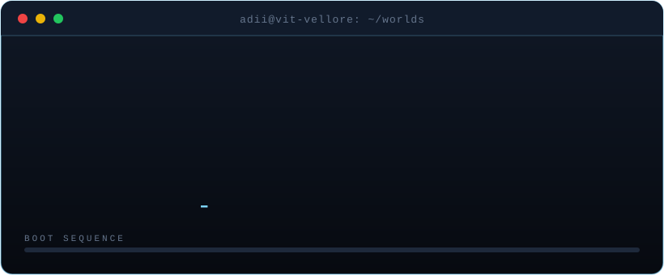
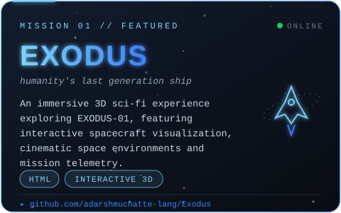
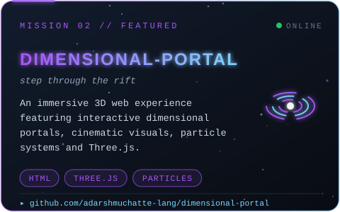
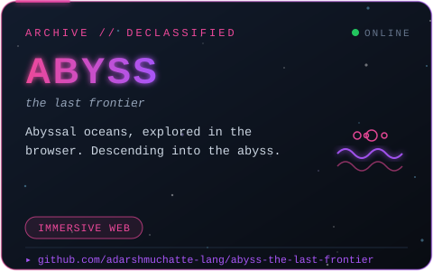
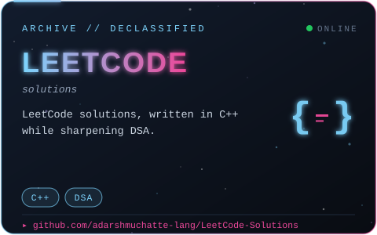
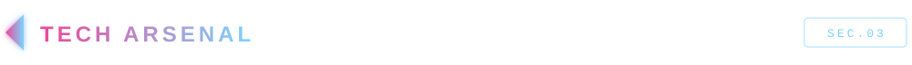
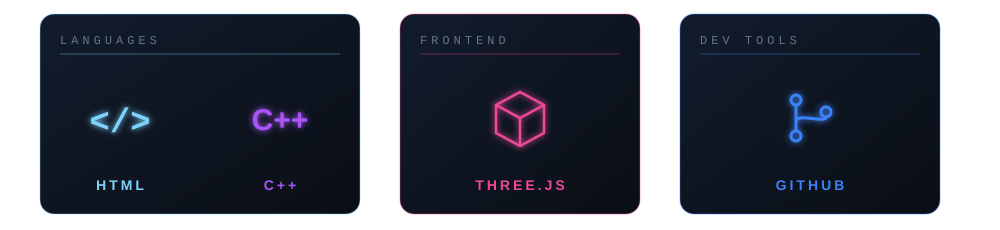

[README_Cosmic_Cyberpunk (1).md](https://github.com/user-attachments/files/34481831/README_Cosmic_Cyberpunk.1.md)

 

 

  

  

---

## `01 / TRANSMISSION`

Hey, I'm **Adarsh Muchatte** — an Information Technology student at **VIT Vellore**, interested in building web experiences that feel as good as they function.

I enjoy combining frontend development, interactive 3D visuals, and practical software engineering. I'm also strengthening my problem-solving and data-structures fundamentals as I work toward software development opportunities.

- 🚀 **Building:** immersive, interactive web projects
- 🌌 **Exploring:** React, Three.js, and modern web development
- 🧠 **Practising:** DSA and problem-solving with C++ and Java
- 🤝 **Interested in:** SDE / full-stack internships and collaborative projects

## `02 / MISSION DOSSIERS`

<table>
  <tr>
    <td width="50%" align="center" valign="top">
      
       
      <strong><a href="https://github.com/adarshmuchatte-lang/Exodus">EXODUS</a></strong>
       
      A futuristic project exploring a generation-ship concept.
    </td>
    <td width="50%" align="center" valign="top">
      
       
      <strong><a href="https://github.com/adarshmuchatte-lang/dimensional-portal">DIMENSIONAL PORTAL</a></strong>
       
      An immersive portal-inspired web experience.
    </td>
  </tr>
  <tr>
    <td width="50%" align="center" valign="top">
      
       
      <strong><a href="https://github.com/adarshmuchatte-lang/abyss-the-last-frontier">ABYSS — THE LAST FRONTIER</a></strong>
       
      An underwater exploration experience built for the browser.
    </td>
    <td width="50%" align="center" valign="top">
      
       
      <strong><a href="https://github.com/adarshmuchatte-lang/LeetCode-Solutions">LEETCODE SOLUTIONS</a></strong>
       
      A place to practise coding problems and improve problem-solving.
    </td>
  </tr>
</table>

> **Recruiter note:** Open a project repository to explore its implementation, technologies, and documentation.

## `03 / TECH ARSENAL`

  
   
  

### Current focus

  
  
  
  

I'm continuing to develop my skills across **React, Node.js, Express, MongoDB, SQL, and modern web development** while building projects and practising DSA.

## `04 / TELEMETRY`

 

  

  

## `05 / OPEN COMMS CHANNEL`

&nbsp;&nbsp;

  

  

