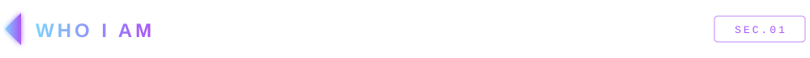
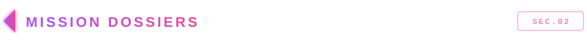
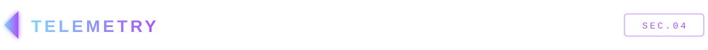

[Uploading README.md…]()

 

 

  

 

Hi, I'm **Adarsh** (ADII) — a B.Tech Information Technology student at **VIT Vellore** who likes building websites you can explore rather than just scroll.

- **What I build:** immersive, interactive web experiences — a generation-ship interface, a shader-driven dimensional portal, and a deep-ocean descent, all running in the browser.
- **What I'm learning:** React and Node.js for full-stack work, and Java alongside C++ for problem solving.
- **What I'm practising:** data structures and algorithms in C++ through [LeetCode-Solutions](https://github.com/adarshmuchatte-lang/LeetCode-Solutions).
- **What I'm looking for:** SDE and full-stack development internships.

If you'd like to see how I work, the mission dossiers below link straight to the code. Open one, read the source, and tell me what you think.

 

<table>
  <tr>
    <td width="50%" align="center">
      
    </td>
    <td width="50%" align="center">
      
    </td>
  </tr>
  <tr>
    <td width="50%" align="center">
      
    </td>
    <td width="50%" align="center">
      
    </td>
  </tr>
</table>

 

 

 

 

 

&nbsp;&nbsp;

 

Or browse everything I've built: [github.com/adarshmuchatte-lang?tab=repositories](https://github.com/adarshmuchatte-lang?tab=repositories)

 

